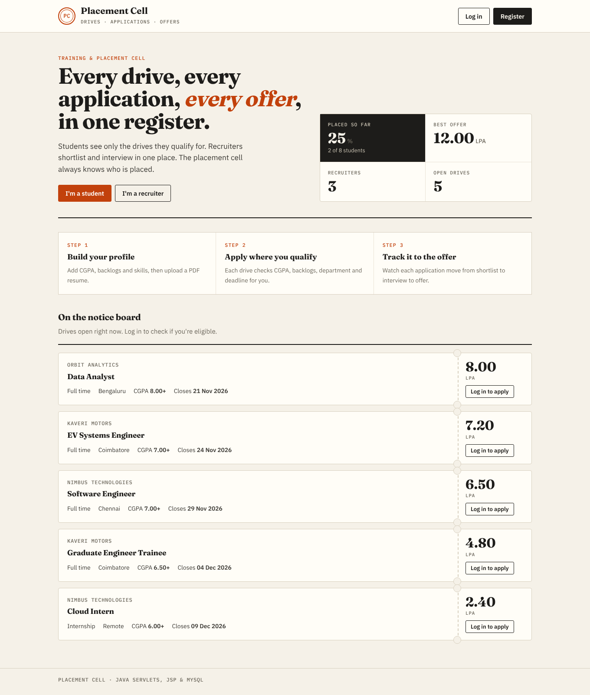
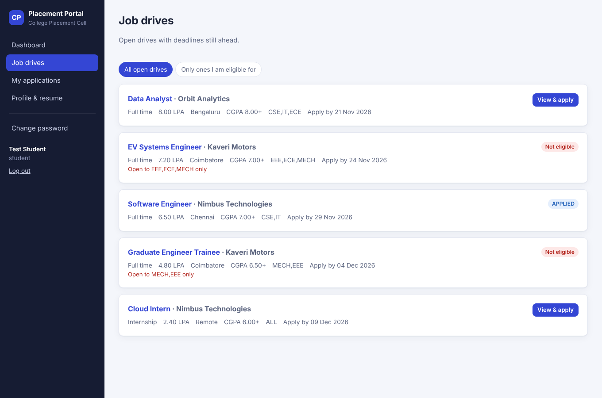
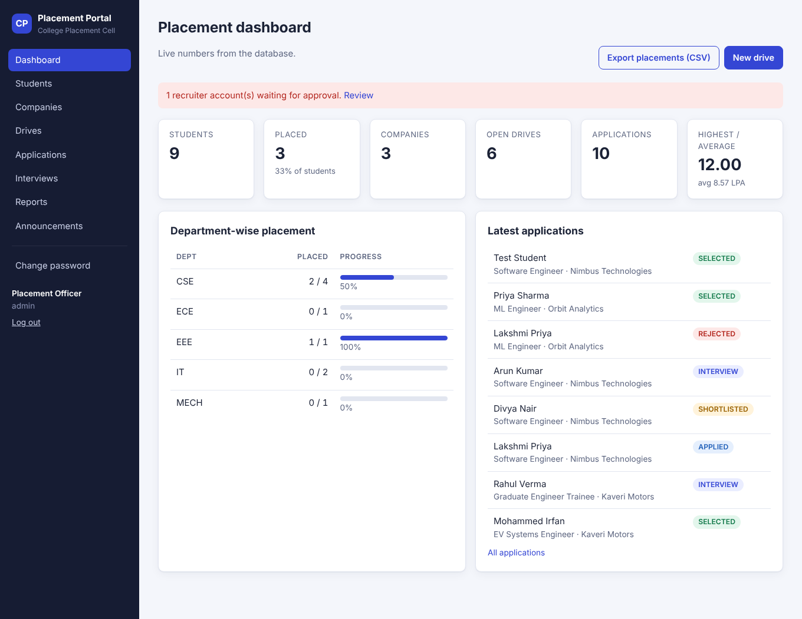
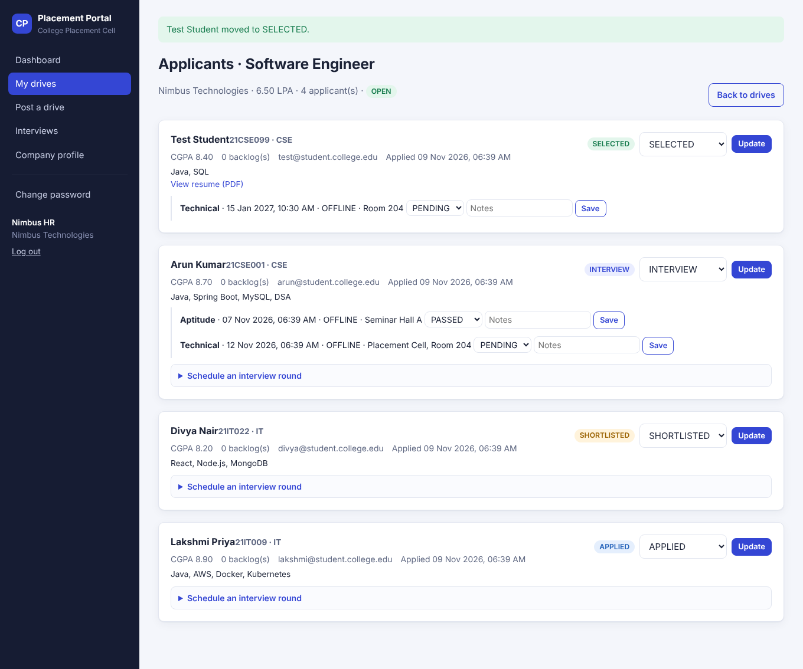
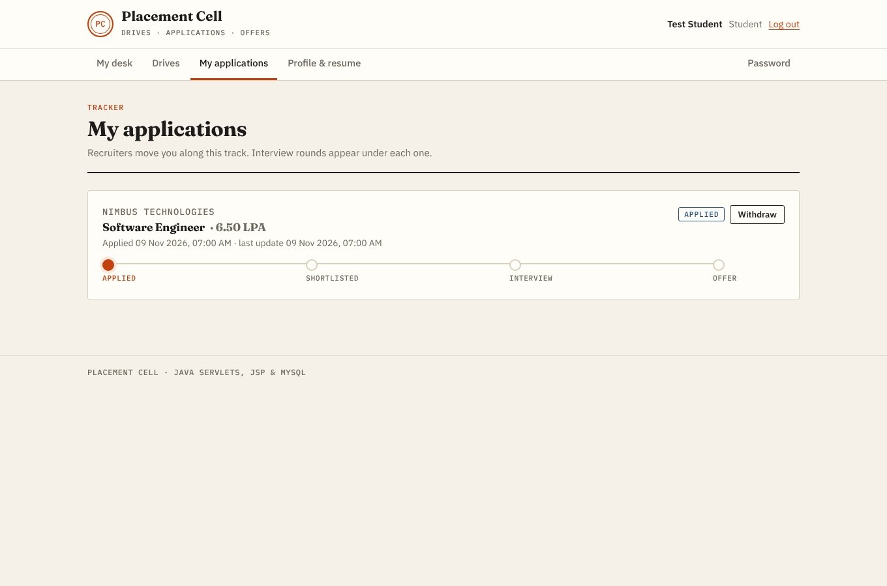
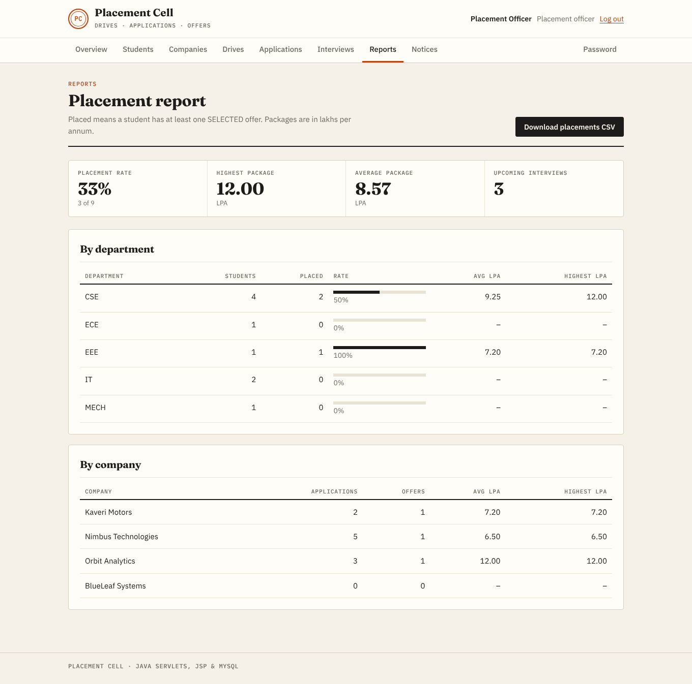

# College Placement Management System

A web app for a college placement cell. Students apply to campus drives, recruiters shortlist and interview them, and the placement officer tracks everything through to the final offer.

**Stack:** Java 17+ · Jakarta Servlets 6 + JSP/JSTL (frontend) · JDBC · MySQL 8 · Maven. No framework, so every SQL query and connection is visible in the code.



### Design
The UI is built to feel like a college notice board and placement register, not a generic admin template: warm paper background, ink-black type, one vermilion accent, serif numerals (Fraunces) with IBM Plex Sans and Mono. Drives are shown as tickets with the package on a tear-off stub. Statuses look like rubber stamps. Every application has a progress track (Applied, Shortlisted, Interview, Offer), so students and recruiters can see where it stands at a glance.

## Features

| Role | What they can do |
|---|---|
| **Placement officer (admin)** | Dashboard with live stats, department-wise placement progress, manage students (search/filter, view, delete), approve or disable recruiter accounts, create/edit/close/delete drives, move any application through its stages, see every interview, reports by department and company, export placements to CSV, post announcements |
| **Student** | Register, edit profile (CGPA, backlogs, skills), upload a PDF resume, browse drives with automatic eligibility checks, apply, withdraw, track status and interview rounds, read announcements |
| **Company (recruiter)** | Register (needs admin approval), edit company profile, post drives with eligibility rules, review applicants and their resumes, shortlist/reject/select, schedule interview rounds and record results |

**Rules the app enforces**
- A student can apply only if the drive is open, the deadline has not passed, and their CGPA, backlogs and department meet the drive's rules.
- A resume must be uploaded before applying. One application per student per drive.
- Once a student is placed (any SELECTED application) they cannot apply to more drives.
- Marking an application SELECTED writes a `placements` row in the same transaction. Moving it away from SELECTED removes that row.
- Scheduling an interview moves an APPLIED/SHORTLISTED application to INTERVIEW, also in one transaction.

**Security basics**
- Passwords are hashed with salted PBKDF2 (JDK only, no plain-text passwords anywhere).
- All SQL uses `PreparedStatement`, so there is no SQL injection.
- A filter enforces role-based access (`/admin/*`, `/student/*`, `/company/*`).
- Every form carries a CSRF token. All user text is escaped with `<c:out>`.
- Companies can only see applicants and resumes for their own drives.
- DB credentials live in a git-ignored `db.properties` or in environment variables.

## Project structure

```
placement-system/
├── db/schema.sql                      MySQL tables, view, sample data, app DB user
├── pom.xml                            Maven build (WAR) + Jetty plugin for quick runs
└── src/main/
    ├── java/com/placement/
    │   ├── util/      Config (reads db.properties/env), DB (JDBC connections), PasswordUtil, Web helpers
    │   ├── model/     User, Student, Company, Job, Application, Interview, Announcement, ReportRow
    │   ├── dao/       One DAO per table + ReportDao for aggregate queries (all JDBC)
    │   ├── filter/    EncodingFilter, CsrfFilter, AuthFilter
    │   └── web/       HomeServlet, AuthServlet, StudentServlet, CompanyServlet, AdminServlet, ResumeServlet
    ├── resources/db.properties.example
    └── webapp/
        ├── assets/style.css
        └── WEB-INF/views/{common,student,company,admin}/*.jsp
```

## Database

Tables: `users`, `students`, `companies`, `jobs`, `applications`, `interviews`, `placements`, `announcements`, plus the view `v_student_placement` used by reports.

```
users 1─1 students ─┐
users 1─1 companies ─┼─ jobs 1─* applications *─1 students
                     │              │
                     │              ├─ 1─* interviews
                     └──────────────┴─ 1─1 placements
```

## Setup

### 1. Install
- JDK 17 or newer (`java -version`)
- Maven 3.8+ (`mvn -v`)
- MySQL 8 (`mysql --version`)

### 2. Create the database

```bash
mysql -u root -p < db/schema.sql
```

This drops and recreates `placement_db`, loads the sample data, and creates a MySQL user `placement_app` (password `change_me`) that can only read and write this database. Change that password in the last lines of `schema.sql` before running it if you like.

### 3. Configure the connection

```bash
cp src/main/resources/db.properties.example src/main/resources/db.properties
```

Edit `db.properties` with your MySQL URL, user and password. It is git-ignored. You can also skip the file and set environment variables instead: `DB_URL`, `DB_USER`, `DB_PASSWORD`, `UPLOAD_DIR`.

### 4. Run

**Quickest (no server install):**

```bash
mvn jetty:run
```

Open http://localhost:8080/

**Or deploy to Tomcat 10.1+:**

```bash
mvn clean package
cp target/placement.war $CATALINA_HOME/webapps/
```

Open http://localhost:8080/placement/

> Tomcat 9 and older use the old `javax.servlet` package and will not run this app. Use Tomcat 10.1 or newer.

**In Eclipse / IntelliJ:** import as a Maven project, add a Tomcat 10.1 server, and run the project on it.

### 5. Log in with the sample accounts

| Role | Email | Password |
|---|---|---|
| Admin | admin@college.edu | admin123 |
| Student | arun@student.college.edu (also priya@, karthik@, divya@, rahul@, sneha@, irfan@, lakshmi@ …student.college.edu) | student123 |
| Company | hr@nimbustech.example, jobs@orbitanalytics.example, talent@kaverimotors.example | company123 |
| Company (awaiting approval) | careers@blueleaf.example | company123 |

Sample students have no resume file yet, so upload any PDF from **Profile & resume** before applying. Company names in the sample data are fictional.

## Put it online

See **[DEPLOY.md](DEPLOY.md)**. The included `Dockerfile` runs on Railway or Render, and creates the tables and sample data on first start. Vercel cannot host it, because it only runs static sites and short functions, not a Java server with MySQL.

## Try this walkthrough
1. Log in as **arun@student.college.edu**, upload a PDF resume, and apply to *Cloud Intern*.
2. Log in as **hr@nimbustech.example**, open *My drives → Applicants* for Cloud Intern, schedule a Technical round, then mark Arun **SELECTED**.
3. Log in as **admin@college.edu**. The dashboard and Reports now count Arun as placed, and *Export placements (CSV)* includes him.

## Troubleshooting
- **"Database error: Access denied"**: the user or password in `db.properties` does not match MySQL.
- **"Communications link failure"**: MySQL is not running, or the host/port in `db.url` is wrong.
- **"Public Key Retrieval is not allowed"**: keep `allowPublicKeyRetrieval=true` in the URL (already in the example).
- **Port 8080 busy**: `mvn jetty:run -Djetty.http.port=9090`.
- **Resumes**: stored in the `uploads/` folder relative to where the server runs (set `upload.dir` to an absolute path for Tomcat).

## Screenshots

| | |
|---|---|
|  |  |
|  |  |
|  | |
